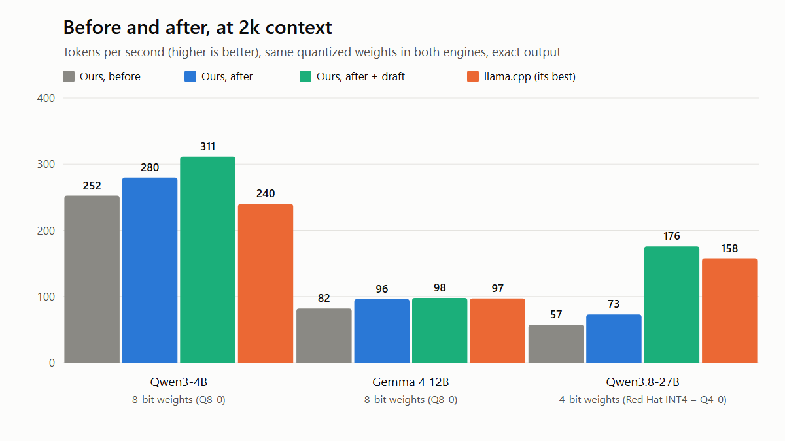

# The story so far: from a layer-skipping idea to faster, exact decoding

Plain-language summary of everything in this repo, in the order it happened (23–25 November 2026).
Every number here comes from a result file in `results/processed/`; the detailed write-ups are
`docs/results_summary.md`, `docs/experiments_e1_e5.md`, `docs/self_speculative_decoding.md` and
`docs/decode_levers.md`. One GPU throughout: an NVIDIA RTX 5090 (32 GB), batch size 1, greedy decoding.

**Two words used everywhere:**
- **Exact** means the output is the model's own greedy text, token for token. We check this by
  re-running the model over its own output and counting "violations": tokens where the engine picked
  something other than the model's clear top choice (a gap of more than 0.25 in the logits). Near-ties
  (two tokens almost equally likely) are allowed to flip, because any change in arithmetic order can
  flip them.
- **Tokens per second (tok/s)** is the steady speed of writing new tokens, prompt reading excluded.

---

## 1. Where we started: "Predictive Layer Execution" (PLE)

A language model is a stack of layers. Each layer waits for the one before it. Our idea: **guess what a
layer will output, start the next layers early on the guess, then fix up the small difference** once the
real output arrives. If the guess is good and the fix is cheap, layers overlap and the model runs faster
with the same answer.

### Our original hypotheses (pre-registered before any results)

| | In plain words |
|---|---|
| H1 | A layer's change to the hidden state is predictable from what came before. |
| H2 | The guessing error has structure (low rank, a few channels, a few tokens) we can exploit. |
| H3 | Fixing the error is cheaper than just computing the layer. |
| H4 | Running the guess in parallel really shortens the time per token. |
| H5 | It works better on prompt reading (prefill) than on writing (decode). |
| H6 | A smart policy (when to guess, where) beats always guessing. |

Models: Qwen3-4B, then Qwen3.5-4B, Ornith-1.5-9B and Qwen3.8-27B.

## 2. What we found: the idea does not pay for itself

| Test | Result | Verdict |
|---|---|---|
| H1, how predictable | The best cheap guess (a linear map) is still **18–19% wrong**. Doing nothing at all ("identity") is 26–34% wrong. Smarter guesses (extrapolation) are worse. | Predictable, but not well enough |
| H2/H3, cheap fix-ups | Spending a quarter of a layer's cost on corrections still leaves **8–12% error**. The error is spread out, not low-rank, not in a few tokens. | **Fail** |
| Quality if we skip the fix | Guessing one layer: +0–2% perplexity. Guessing every layer: perplexity 11.4 → 13.3 (Qwen3-4B) and up to 12,000 with the naive guess. | Only works for a few layers |
| H4, real overlap on the GPU | At most **+7–16% per guessed layer** for 1–16 tokens, nothing above 512 tokens. End to end, about 2–4%. | Too small |
| Phase II, a map of which parts can be skipped | Removing 10% of the compute costs **+13–17% perplexity**. The best safe set removes 1–2%. | Misses the goal by 10× |
| E1–E5, five rescue attempts (per-token gates, LoRA healing, trained predictors, FP8 side-branch, decode timing) | None reached ≥ 5% faster with ≤ 1% quality loss. Healing plateaus; a trained predictor is no better than ridge regression. | **All fail** |
| Self-speculation by skipping layers (draft = the model with layers skipped, then verify) | Exact, but **0.94× (slower)**: a draft with 26% of layers skipped still costs 82% of a full step. | **Fail** |

**Lesson:** a modern LLM's layers are not redundant enough to guess cheaply, and the GPU cannot overlap
the guess with the real work well enough at batch 1.

### One useful finding along the way: precision decides if "exact" is possible

When we fixed a guess *exactly*, the answer only stayed exact if the model's **weights** were quantized
but the **activations** stayed in 16 bits. INT8 and 4-bit weight-only (Red Hat's Qwen3.8 INT4, NVFP4
W4A16) stayed exact. Anything that also rounds activations (FP8 W8A8, NVFP4 W4A4) broke exactness
3–100× above the floor. This matters later: it is why our engine keeps activations in BF16.

## 3. The turn: where does a token's time actually go?

Instead of guessing layers, we profiled one decode step of Qwen3-4B (8.7 ms per token in our original
decoder) and fixed the parts one at a time. Each fix had a speed bar set in advance and had to keep the
output exact.

| Lever | What it does | Speed-up (Qwen3-4B, BF16) | Exact? |
|---|---|---|---|
| L1 | Fuse the q/k norm and the rotary position step | 1.06× | yes |
| L2 | Fast attention (cuDNN, or batched matmuls for large heads) | 1.27× | yes |
| L1 + L2 | Both | **1.36×** (115 → 156 tok/s) | yes |
| L6 | Just run a 4-bit copy of the model | 3.3× | **no**, +16–19% perplexity |
| **L7 / L7b** | **Use the 4-bit copy as a draft** that guesses 6 tokens; the full model checks them all in one pass and keeps the ones it agrees with. The whole round is one CUDA graph. | **2.13× over the original** (244–258 tok/s) | **yes**, 0 violations |

L7 is "speculative decoding", a known technique, with the model's own 4-bit copy as the draft. What we
added is making the draft good (GPTQ with a clipping search, groups of 32: perplexity +2.8% instead of
+19%, so it is right ~90% of the time) and making the round cheap (draft, verify and accept all inside
one CUDA graph, no CPU round-trips).

### Checks
- **Replicated** in a fresh process: every speed-up within 0.5%.
- **Second model**, TinyLlama-1.1B: 1.60× exact levers, 2.14× with the draft.
- **Against Hugging Face Transformers** `generate` (32 tok/s): ours 5× faster without the draft, 7.7–8.1× with it.
- **Against llama.cpp** (BF16, same prompts): plain decoding is level (ours 156–160, llama.cpp 162). With
  a draft, llama.cpp gets 156–185 and we get 244–258: **1.5–1.6× faster, same text.**

## 4. Bigger, newer models

| Model | Notes | Exact levers | vs llama.cpp |
|---|---|---|---|
| Gemma 4 12B | New decoder written for it. Gemma in BF16 is fragile: Transformers disagrees with *itself* 31 times, so its gate was made "no worse than Transformers" (decided and written down before any timing). | 1.20× (42 → 51 tok/s) | llama.cpp 59, we trail by 14% |
| Qwen3.8-27B (INT4) | Hybrid model: most layers are Gated DeltaNet (a recurrent layer), not attention. Decoder passes the gate (KL 0.0011, top-1 99.4%). | 1.06× | llama.cpp 75, we trail at 57 |

No INT4 self-draft on Qwen3.8: it is already 4-bit, so a 4-bit copy is no cheaper.

## 5. Real-world lengths, and a fair fight with llama.cpp

Real use means long conversations and quantized models, not 16-bit weights and short prompts. So we:
1. tested at **2k, 4k, 8k, 16k, 32k, 64k and 128k** tokens of context and only report the stable speed;
2. made the **weights byte-identical** in both engines: we wrote llama.cpp's Q8_0 format ourselves
   (codes match `llama-quantize` byte for byte), and wrote our own 4-bit draft codes and Red Hat's
   Qwen3.8 INT4 codes into GGUF files so llama.cpp runs exactly the same numbers;
3. used **BF16 KV cache** in both; YaRN for Qwen3-4B above 32k in both.

**BF16 results (follow-up J):** Qwen3-4B ours 157 → 56 tok/s from 2k to 128k, llama.cpp 157 → 42; with
the draft we are 251 at 2k. Gemma: ours 51 → 46, llama.cpp 59 → 47. Qwen3.8: ours 57 → 30, llama.cpp 75 → 35.

**8-bit targets (follow-up K).** At 8 bits the draft matters less: a 4-bit draft step costs about two
thirds of an 8-bit target step, because ~0.9 ms of each step is thousands of tiny kernels that do not
shrink with the weights. That pointed to the next fix.

**2-bit drafts: a dead end.** A pure 2-bit Qwen3-4B guesses the 8-bit model's tokens only 27–53% of the
time; 2-bit Gemma 4 12B almost never (0–1%). Speculation needs ~75%. We did not build a 2-bit kernel.

## 6. Fusing the tiny kernels (follow-up F3a)

The profile showed thousands of small kernels per token: Qwen3-4B 655 (0.9 ms), Gemma 4 12B 3,039
(3.4 ms), Qwen3.8 4,940 (5.9 ms). Compiling the whole step with `torch.compile` was *slower* (it turned
every KV-cache write into a full copy). Compiling only the small pure pieces (norm + residual, q/k norm
+ RoPE, activations, Gemma's softcap, Qwen3.8's whole one-token DeltaNet update) worked:

| 2k context | Before | After | Gain | Violations |
|---|---|---|---|---|
| Qwen3-4B Q8_0 | 256 | 280 | +9% | 0 |
| Qwen3-4B Q8_0 + 4-bit draft | 257 | **311** | **+21%** | 0 |
| Gemma 4 12B Q8_0 | 82 | 96 | +18% | 0 |
| Qwen3.8 INT4 | 58 | **74** | **+28%** | 0 |

Gemma's kernel count went 3,039 → 1,205 per token; matmuls are now 93% of its step.

## 7. Qwen3.8's own draft: its multi-token-prediction (MTP) layer

Qwen3.8 is already 4-bit, so a 4-bit copy of itself is no cheaper. But it ships with a small extra
layer trained to guess the *next-next* token (MTP). One MTP step costs one layer plus the output head
instead of 64 layers. We use it as the draft: it guesses k tokens, the full model checks them in one
pass, and the whole round (MTP guesses, check, accept, roll back the recurrent DeltaNet state to the
last kept token) is one CUDA graph. The check pass also got the fused kernels.

**A bug we found by comparing with llama.cpp.** Our first version fed the MTP layer the model's hidden
state *before* its final normalization. llama.cpp's MTP on the same file was accepted more often (86% vs
79% at 2k, k = 4) and ran faster (157.5 vs 140.7 tokens/s). Reading llama.cpp's code showed it feeds the
state *after* the final norm, as the model was trained. Fixed, rerun, both runs kept on file.

After the fix (one prompt per context, 256 tokens, 2 timed runs; k = how many tokens the MTP guesses per round):

| Context | Ours, fused step | Ours + MTP (best k) | llama.cpp plain | llama.cpp + its MTP (best k) |
|---|---|---|---|---|
| 2k | 73 | **150** (k = 4) | 76 | **158** (k = 4) |
| 4k | 72 | **120** (k = 3) | 74 | **127** (k = 3) |
| 8k | 69 | **102** (k = 4) | 73 | **117** (k = 4) |
| 16k | 65 | **113** (k = 3) | 70 | **127** (k = 4) |
| 32k | 58 | **88** (k = 3) | 61 | **90** (k = 2) |
| 64k | 47 | **79** (k = 3) | 48 | **87** (k = 3) |
| 128k | 35 | **58** (k = 3) | 35 | **60** (k = 3) |

- **The MTP draft makes Qwen3.8 1.5–2× faster with the model's own output** (0 violations for k = 2, 3, 4).
- **llama.cpp's own MTP is still 2–13% faster than ours.** The draft is accepted equally often in both
  engines, so llama.cpp's draft-and-check round is a little cheaper.
- How often the draft is right depends a lot on the text: 87% on the 2k prompt, 53% on the 8k one.

**The last step: a 4-bit output layer for the draft only.** Every MTP guess reads Qwen3.8's whole
output layer (248,320 words × 5,120 numbers, 2.5 GB in 16-bit). We gave the *draft* a 4-bit copy of it
(0.6 GB). The full model still checks every token with the real 16-bit layer, so the output does not
change (0 violations), and the draft is right just as often. Written down as follow-up H2 before running:

| Context | Ours, fused step | Ours + MTP, 4-bit draft head | llama.cpp + its MTP | Ours / llama.cpp |
|---|---|---|---|---|
| 2k | 73 | **176** (k = 4) | 158 | **1.11×** |
| 4k | 71 | **137** (k = 3) | 127 | **1.08×** |
| 8k | 69 | 110 (k = 4) | **117** | 0.94× |
| 16k | 65 | **133** (k = 4) | 127 | **1.05×** |
| 32k | 58 | **97** (k = 4) | 90 | **1.08×** |
| 64k | 47 | 86 (k = 3) | **87** | 0.98× |
| 128k | 35 | **62** (k = 3) | 60 | **1.04×** |

Ahead of llama.cpp's own MTP at 5 of 7 lengths, 2–6% behind at the other two, and 1.6–2.4× faster than our
plain step everywhere. (The 128k run spilled about 0.2 GB of GPU memory into system RAM, so it may read low.)

## 8. Inkling 2 Mini (Thinking Machines, released 20 November 2026)

Inkling 2 Mini is a very different design: a mixture of experts (128 small expert networks, 8 used per
token), a block of layers that runs **three times in a loop**, mostly sliding-window attention, and
4-bit NVFP4 expert weights. Our decoders do not run this architecture, and porting it (experts, the
loop, a new attention variant, an NVFP4 kernel) is a project of its own. So for now we only measured it
in llama.cpp (b12720), converted with llama.cpp's own converter and quantized to Q4_K_M, the most common
way people run GGUF models (17.5 GB):

| Context | 2k | 4k | 8k | 16k | 32k | 64k | 128k |
|---|---|---|---|---|---|---|---|
| Tokens/s | 97 | 95 | 93 | 91 | 86 | 78 | 66 |

(llama.cpp b12720, Q4_K_M, BF16 KV, one prompt per length, 2 timed runs. At 128k llama.cpp's default
prompt batch needed 12.9 GB of scratch memory and failed to start; with `-ub 128 -b 128` it fits. That
setting changes only prompt reading, not the writing speed measured here.)

The text it writes is coherent (checked by reading it), but we did not run an exactness check: we have
no reference implementation of this model on this GPU. Inkling is the obvious next target for our
engine: with only 8 of 128 experts active per token, each token reads few weights, so the tiny-kernel
overhead we removed elsewhere will matter even more here.

## Where we landed

Same quantized weights in both engines (byte for byte), same KV cache, one prompt per length, 2 timed
runs, tokens per second. "Before" = our exact step when we first matched llama.cpp (fast attention + fused
RoPE); "after" = with the fused tiny kernels; "+ draft" = after, plus the model's own draft (a 4-bit copy
for Qwen3-4B and Gemma, the MTP layer with a 4-bit draft head for Qwen3.8), one fixed setting per model.
A draft only counts as "ours" if its output check had 0 violations.

**Gemma 4 12B** (draft: l7bc, not exact, not counted)

| Context | Ours before | Ours after | Ours + draft | llama.cpp | llama.cpp + its draft | Our best / their best |
|---|---|---|---|---|---|---|
| 2k | 82 | 96 | 98 | 97 | 64 | 0.99× |
| 4k | 82 | 96 | 52 | 97 | 81 | 0.99× |
| 8k | 81 | 95 | 110 | 95 | 84 | 1.00× |
| 16k | 80 | 94 | 102 | 93 | 81 | 1.01× |
| 32k | 77 | 91 | 67 | 90 | 58 | 1.02× |
| 64k | – | 86 | 96 | 81 | 49 | 1.05× |
| 128k | – | 80 | – | 68 | 53 | 1.17× |

**Qwen3.8-27B** (draft: mtp4_h4, exact)

| Context | Ours before | Ours after | Ours + draft | llama.cpp | llama.cpp + its draft | Our best / their best |
|---|---|---|---|---|---|---|
| 2k | 57 | 73 | 176 | 76 | 158 | 1.11× |
| 4k | 56 | 72 | 136 | 74 | 127 | 1.07× |
| 8k | 55 | 69 | 110 | 73 | 117 | 0.94× |
| 16k | 52 | 65 | 133 | 70 | 127 | 1.05× |
| 32k | 47 | 58 | 97 | 61 | 90 | 1.08× |
| 64k | 40 | 47 | 83 | 49 | 87 | 0.95× |
| 128k | 30 | 35 | 56 | 34 | 60 | 0.93× |

**Qwen3-4B** (draft: l7bc, exact)

| Context | Ours before | Ours after | Ours + draft | llama.cpp | llama.cpp + its draft | Our best / their best |
|---|---|---|---|---|---|---|
| 2k | 252 | 280 | 311 | 240 | 164 | 1.30× |
| 4k | 240 | 265 | 292 | 226 | 181 | 1.29× |
| 8k | 221 | 241 | 243 | 205 | 149 | 1.19× |
| 16k | 191 | 206 | 179 | 174 | 119 | 1.19× |
| 32k | 150 | 159 | 137 | 128 | 80 | 1.24× |
| 64k | 104 | 109 | 82 | 82 | 54 | 1.33× |
| 128k | 65 | 66 | 46 | 46 | – | 1.43× |

**Inkling 2 Mini, llama.cpp Q4_K_M**

| Context | 2k | 4k | 8k | 16k | 32k | 64k | 128k |
|---|---|---|---|---|---|---|---|
| Tokens/s | 97 | 95 | 93 | 91 | 86 | 78 | 66 |

(For Qwen3.8 the draft column is the MTP layer with the 4-bit draft head, k = 4 at every length; k = 3 is
faster at some lengths, see section 7. llama.cpp's draft for Qwen3.8 is its own MTP.)

**In short:**
- **Qwen3-4B (8-bit):** faster than llama.cpp at every length, 1.19–1.43×.
- **Gemma 4 12B (8-bit):** from 15–19% behind to level up to 16k and ahead beyond, 1.17× at 128k. Its
  4-bit self-draft is fast on some prompts and slow on others and changes 1 token in 128, so it is not counted.
- **Qwen3.8-27B (4-bit):** the plain step went from 23% behind to level at 128k. With its MTP draft (both
  engines using MTP) we are ahead at 2k, 4k, 16k, 32k and 128k (best k), and 2–6% behind at 8k and 64k.
- **Inkling 2 Mini:** llama.cpp only, 97 → 66 tokens/s from 2k to 128k; our engine does not run it yet.

Charts: `docs/articles/figures/` (`before_after_*.png`, `journey_qwen3_4b.png`); the interactive version is the
dashboard. All numbers: `results/processed/story/story.json`, built by `scripts/build_story_data.py` from the
raw result files it names; tables by `scripts/story_tables.py`.

## What helped, what did not

**Helped (exact, measured):**
1. A CUDA-graph decode step with fast attention and fused RoPE (L1 + L2).
2. Fusing the many small kernels (F3a): biggest on models with many small ops (Qwen3.8 +28%, Gemma +18%).
3. The model's own 4-bit copy as a draft (L7b): big on 16-bit targets, smaller on 8-bit, short context only;
   the whole draft-and-check round inside one CUDA graph.
4. Qwen3.8's own MTP layer as the draft (H), fed the right hidden state, with a 4-bit draft-only output
   layer (H2): 1.6–2.4× over the plain step, ahead of llama.cpp's MTP at 4 of 6 lengths.
5. Matching llama.cpp's Q8_0 exactly, so the 8-bit model runs ~1.6× faster than BF16 with a fair comparison.

**Did not help:**
1. Guessing layer outputs (the original PLE idea), in every form we tried.
2. Skipping layers as a draft.
3. 2-bit drafts.
4. Compiling the whole step at once.
5. Self-drafts at long context with an 8-bit target: the verify pass gets expensive and the draft loses.
6. Our first MTP version (wrong hidden state): it worked, but was accepted less often; comparing with
   another engine's code found the bug.

## Honest limits

- One GPU (RTX 5090), Windows, batch size 1, greedy decoding, base models. Servers with many users at
  once (batching) are a different problem and were not tested.
- llama.cpp is a general engine that runs everywhere; ours is a research decoder for a few model families.
- Single prompt per context for the long-context runs (2 timed runs each), as decided to keep runs short.
- Gemma's self-draft speed swings with the prompt (acceptance 0.3–0.9), and it shows 1 violation in
  128 tokens on each check prompt (Gemma's known fragility; Transformers disagrees with itself 31 times).
