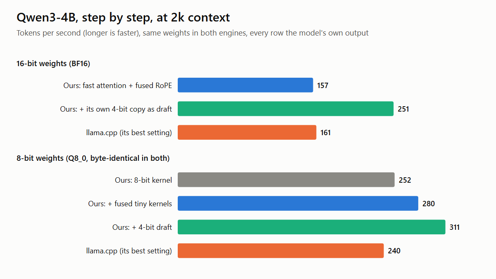
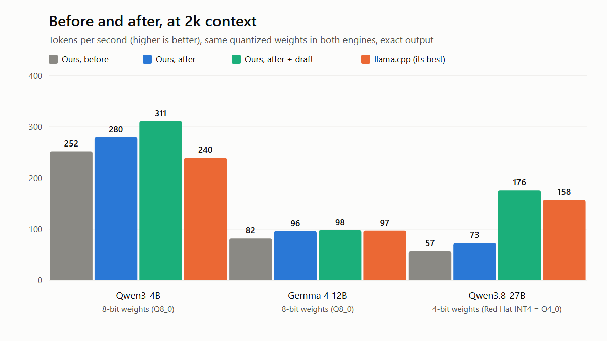
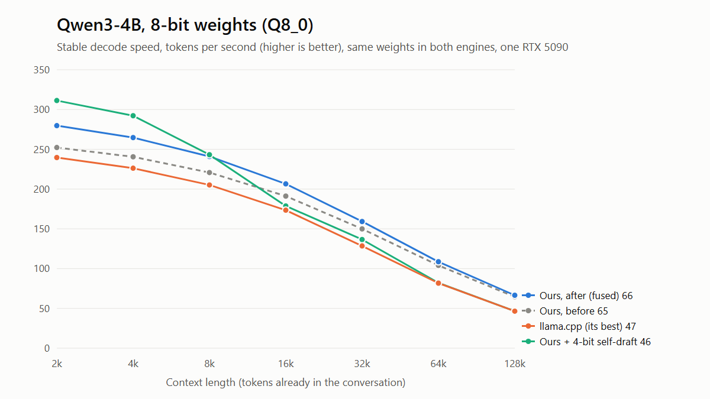
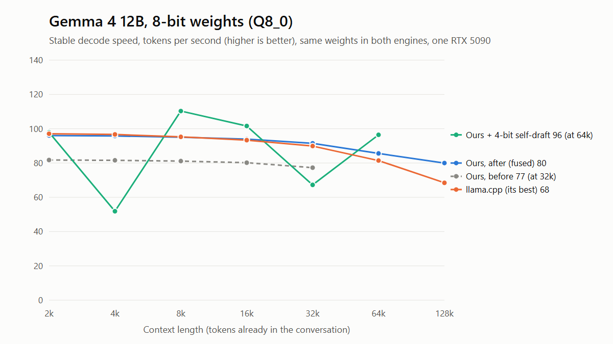
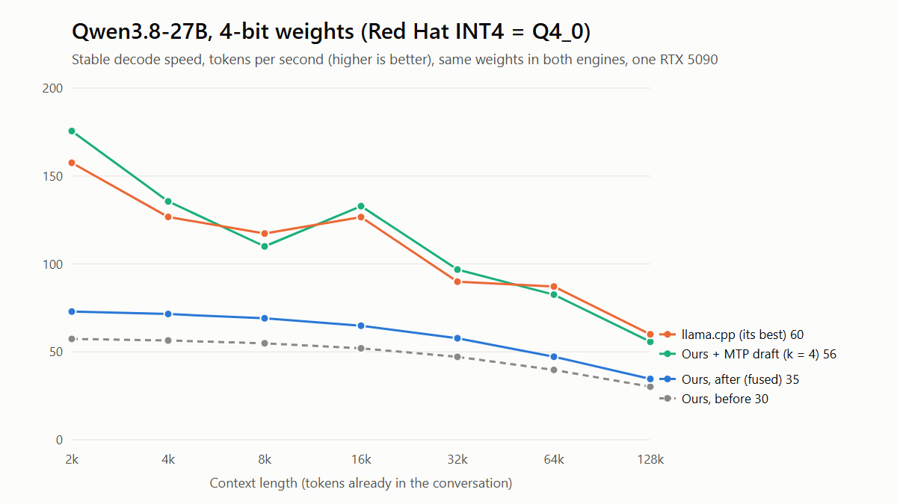

# My idea to speed up LLMs failed. Here's what actually worked.

*Draft for Medium. Charts are in `docs/articles/figures/` (PNG). Not posted.*

---

I spent a few days trying to make large language models write faster on a single GPU. My first idea
didn't work. Not even close. But chasing it taught me where the time really goes, and that led to
changes that make today's popular open models (Qwen3, Gemma 4, Qwen3.8) write **as fast as or faster than
llama.cpp on the same weights (up to 1.43×), with exactly the same output**.

This is the whole story, failures included. Every number comes from a result file in the repo:
github.com/raja-gamevrs/predictive-layer-execution

## The setup

- One NVIDIA RTX 5090 (32 GB), Windows, one user at a time (batch size 1), greedy decoding.
- "Speed" means steady tokens per second while writing, not counting reading the prompt.
- "Exact" means the output is the model's own text, token for token. I check this every time by
  re-running the model over its own output and counting tokens where the engine picked something
  other than the model's clear first choice.

## The original idea: guess the next layer

A language model is a tall stack of layers, and each layer waits for the one below it. My idea,
"Predictive Layer Execution", was simple:

1. **Guess** what a layer will output.
2. **Start** the next layers early, using the guess.
3. **Fix** the small difference once the real output arrives.

If the guess is good and the fix is cheap, layers overlap and the model gets faster without changing
its answers. I wrote down six hypotheses and pass/fail bars *before* running anything, so I couldn't
fool myself later.

## What I found: layers are not that predictable

- **The best cheap guess is still 18–19% wrong.** Doing nothing (assume the layer changes nothing) is
  26–34% wrong. Fancier guesses were worse.
- **Fixing the error is not cheap.** Spending a quarter of a layer's cost on corrections still left
  8–12% error. The error is spread everywhere: not in a few channels, not in a few tokens.
- **Skipping the fix hurts quality fast.** Guess one layer: fine (+0–2% perplexity). Guess them all:
  perplexity goes from 11.4 to 13.3 at best.
- **The GPU can't overlap much anyway.** Real overlap saved 7–16% *per guessed layer* for short inputs
  and nothing for long ones, about 2–4% end to end.
- I tried five more rescues (smart per-token gates, LoRA "healing", trained predictors, FP8 side
  branches) and a "skip layers to make a draft" trick. **All failed** their bars. The skip-layer draft
  was actually *slower*: a draft with 26% of layers skipped still cost 82% of a full step.

The honest conclusion: modern LLM layers are not redundant enough to guess cheaply.

One useful thing fell out: keeping the answer exact only works when the model's **weights** are
quantized but the **activations** stay 16-bit. Rounding activations too (FP8 W8A8, NVFP4 W4A4) broke it.

## The turn: profile first, then fix

So I stopped guessing and measured one decode step instead. On Qwen3-4B my decoder took 8.7 ms per
token. I fixed it one piece at a time, each with a bar set in advance:

| Change | Speed-up | Same output? |
|---|---|---|
| Fuse the q/k norm with the rotary position step | 1.06× | yes |
| Faster attention kernels | 1.27× | yes |
| Both | 1.36× | yes |
| Just use a 4-bit copy of the model | 3.3× | **no** (+16–19% perplexity) |
| **Use the 4-bit copy as a draft, let the full model check it** | **2.13×** | **yes** |

The last row is speculative decoding, a well-known technique: a small fast model guesses a few tokens,
the big model checks them all in one pass and keeps the ones it agrees with. Two things made it work
well here:
- **A good draft.** The model's own 4-bit copy, quantized carefully (GPTQ with a clipping search,
  groups of 32), agrees with the full model about 90% of the time.
- **A cheap round.** Drafting, checking and accepting all run inside one CUDA graph, with no trips
  back to the CPU.

Against llama.cpp on the same prompts: plain decoding was level (156–160 vs 162 tok/s). With a draft,
llama.cpp got 156–185 and mine got 244–258. Same text.

## Making the comparison fair

Then I had to face the obvious objection: nobody runs these models in BF16 with
2,000 tokens of context. Real use means **quantized models** and **long conversations**. So I:

- matched the weights **byte for byte** with llama.cpp (I re-implemented its Q8_0 format and checked
  every byte, and wrote my own 4-bit codes into GGUF files so llama.cpp runs the same numbers);
- used the same 16-bit KV cache in both;
- measured at 2k, 4k, 8k, 16k, 32k, 64k and 128k tokens of context.

Two more lessons:
- **2-bit drafts are useless here.** A 2-bit Qwen3-4B guessed the 8-bit model's tokens only 27–53% of
  the time; a 2-bit Gemma 4 12B almost never. Speculation needs roughly 75%.
- **Thousands of tiny GPU kernels were the real tax.** Gemma 4 12B launched 3,039 kernels per token;
  Qwen3.8 launched 4,940. Compiling the whole step with `torch.compile` made it *slower* (it turned
  every cache write into a full copy). Compiling only the small pure pieces (norms, activations, the
  rotary step, Qwen3.8's recurrent DeltaNet update) cut Gemma to 1,205 kernels and made Qwen3.8 28%
  faster.

## Before and after, against llama.cpp

**Qwen3-4B (8-bit).** Faster than llama.cpp at every length: 311 vs 240 tokens/s at 2k (with the
model's own 4-bit draft), 66 vs 46 at 128k (the draft stops paying past 8k, so the plain fused step wins there).

**Gemma 4 12B (8-bit).** Before the kernel fusion I was 15–19% behind llama.cpp. Now it's level up to
16k and ahead from 32k, with the biggest lead at 128k (80 vs 68). Gemma's 4-bit self-draft is fast
on some prompts and slow on others, and it changes one token in 128 (Gemma is numerically fragile: its
own reference code disagrees with itself 31 times on the same text), so I don't count it.

**Qwen3.8-27B (4-bit).** This one taught me the most. The fused kernels took it from 23% behind llama.cpp
to within 2–7%, and level at 128k. Then I used the model's own multi-token-prediction (MTP) layer as the draft. My first version
lost to llama.cpp's own MTP on the same file (141 vs 158 tokens/s). Reading llama.cpp's code showed I was
feeding the MTP layer the hidden state *before* the final normalization instead of after. Fixing it
closed most of the gap (150 vs 158). The last step was noticing that every draft step reads the whole
2.5 GB output layer: giving the *draft* a 4-bit copy of that layer, while the full model still checks
every token with the real one, made it 176 tokens/s at 2k, faster than llama.cpp's MTP, with exactly the same output. Across lengths
it is ahead at 2k, 4k, 16k, 32k and 128k and 2–6% behind at 8k and 64k (how often the draft is right depends
heavily on the text, in both engines).

**Inkling 2 Mini** (Thinking Machines, out on 20 November) is a mixture-of-experts model with a block
of layers that runs three times in a loop. My engine doesn't run it yet, so I only measured llama.cpp:
97 tokens/s at 2k context down to 66 at 128k (4-bit Q4_K_M). With only 8 of its 128 experts
active per token, it reads few weights per token, which makes it the next model where cutting tiny-kernel
overhead should pay off most.

## What I'd tell someone trying this

1. **Measure before you invent.** My clever idea lost to a profiler and a list of boring fixes.
2. **Write the bar down first.** Several results looked good until I compared them to the bar I had
   set before running.
3. **Check exactness every time.** Speed that changes the model's answer is a different model.
4. **Kernel launch overhead is real** on big modern models with many small operations.
5. **Speculation is about cost per round, not just the draft.** The same draft gave llama.cpp nothing
   and gave my engine 1.5×, because my whole round was one GPU graph.
6. **Read the other engine's code.** Losing to llama.cpp on Qwen3.8 is how I found my MTP bug.

## Limits

One GPU, one user at a time, greedy decoding, base models, Windows. Serving many users at once is a
different problem. llama.cpp runs on everything; my decoder handles a few model families. I used one
prompt per context length for the long-context runs and two timed runs each.

Code, results and every pre-registered bar: github.com/raja-gamevrs/predictive-layer-execution
